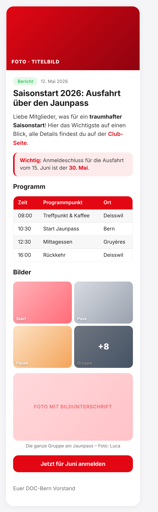
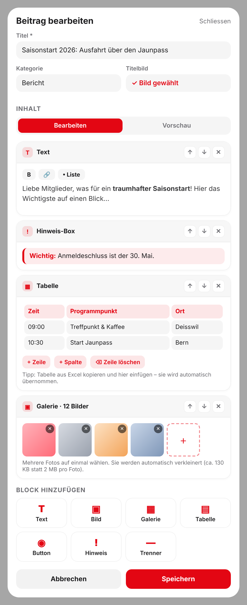

# Vorschlag: News-Beiträge mit Tabellen, Bildergalerien & Co.

Status: **Vorschlag zur Entscheidung**, noch nichts umgesetzt.
Ziel: Die App ersetzt CleverReach als Ort für Club-Neuigkeiten. Beiträge sollen wie ein
Newsletter aussehen können (Tabellen, Galerien, Buttons, Hinweise), aber **einfach zu
erstellen** und **schön auf dem Handy** sein.

---

## 1. Ausgangslage (Ist-Zustand)

| Thema | Heute |
|---|---|
| Beitragstext | Ein einziges Textfeld. Es gibt nur Absätze, keine Fettschrift, keine Links im Text, keine Tabellen. |
| Bilder | Genau **ein** Titelbild pro Beitrag. |
| Links | Eine Liste von Buttons unter dem Text. |
| Bild-Upload | Vorhanden und zuverlässig: direkt vom Browser zu Vercel Blob (auch grosse Handy-Fotos). **Wiederverwendbar.** |
| Entwurf / Planung / Archiv / Kategorie | Vorhanden. Bleibt unverändert. |
| Anzeige | Kachel, die sich in der Kachel aufklappt. |

Fazit: Die Basis (Upload, Entwürfe, Planung, Archiv, Design) ist da. Es fehlt nur
**strukturierter Inhalt** statt eines reinen Textfelds.

## 2. Leitplanken

1. **Einfach für Admins:** keine Fachbegriffe, nichts programmieren, nichts "formatieren müssen".
2. **Schön für Mitglieder:** immer im Design der App, auch wenn man als Admin "falsch" gestaltet.
3. **Sicher & stabil:** keine freie HTML-Eingabe, die das Layout zerschiessen oder Schadcode einschleusen könnte.
4. **Bestehende Beiträge bleiben unverändert** und funktionieren weiter.
5. **In kleinen Schritten**, jeder Schritt einzeln prüfbar.

## 3. Lösungsansätze im Vergleich

| | A) Markdown-Text | **B) Bausteine (Blöcke)** ✅ | C) Voller Texteditor (WYSIWYG) |
|---|---|---|---|
| Idee | Admin schreibt `**fett**`, `\| Tabelle \|` | Beitrag = Liste von Bausteinen: Text, Bild, Galerie, Tabelle, Button, Hinweis … | Wie Word im Browser |
| Einfachheit für Admins | schlecht (Syntax lernen, Tabellen mühsam) | **sehr gut** (Baustein wählen, ausfüllen) | gut |
| Aussehen für Mitglieder | gut | **sehr gut, immer einheitlich** | uneinheitlich (Copy-Paste aus Word bringt Chaos) |
| Risiko / Fehleranfälligkeit | mittel | **gering** | hoch (grosse Fremdbibliothek, HTML-Bereinigung) |
| Passt zur App (Handy, Design) | mittel | **ja** | mässig |

**Empfehlung: B) Bausteine.** Es ist der einfachste Weg, dass Admins schnell hübsche Beiträge
bauen und Mitglieder immer ein sauberes Ergebnis sehen. Die Tabelle wird wie in Excel
ausgefüllt, nicht programmiert.

## 4. Der Vorschlag: Beitrag aus Bausteinen

### Bausteine, Etappe 1 (Kern)

| Baustein | Was der Admin macht | Was Mitglieder sehen |
|---|---|---|
| **Text** | Text tippen; Buttons für **fett**, Link, Aufzählung | Saubere Absätze, fette Wörter, Links in Ducati-Rot |
| **Bild** | Foto hochladen, optional Bildunterschrift | Volle Breite, abgerundet, Unterschrift darunter |
| **Galerie** | Mehrere Fotos auf einmal wählen | Raster (2 Spalten Handy / 3 Desktop), "+8" bei vielen; Tippen öffnet Grossansicht zum Wischen |
| **Tabelle** | Felder ausfüllen, "+ Zeile / + Spalte", **Excel-Tabelle einfügen** | Rote Kopfzeile, Streifenmuster, auf dem Handy seitlich scrollbar |
| **Button** | Beschriftung + Link | Grosser roter Button (z. B. "Jetzt anmelden") |
| **Hinweis-Box** | Kurzen Text eingeben | Hervorgehobene Box (z. B. "Wichtig: Anmeldeschluss …") |
| **Trennlinie** | ein Klick | Dezente Linie |

### Bausteine, Etappe 2 (später, bei Bedarf)

Datei/PDF zum Herunterladen (z. B. GV-Protokoll), Event-Karte ("Zum Event"), Zitat.
Das Datenmodell ist dafür von Anfang an offen. **Video ist bewusst nicht vorgesehen** (nicht benötigt).

### So sieht es aus

Beitrag aus Sicht der Mitglieder (Handy; auf dem Desktop praktisch gleich breit wie die Kachel):

Editor aus Sicht der Admins (Bausteine untereinander, Pfeile zum Verschieben, "Block hinzufügen" unten):

*(Die Mockups sind Entwürfe mit Platzhalter-Fotos und Beispieltexten. Im fertigen Editor
gibt es zusätzlich den Umschalter "Bearbeiten | Vorschau", der den Beitrag genau so zeigt, wie ihn
Mitglieder sehen.)*

## 5. Bedienung für Admins (Ablauf)

1. Admin → News → **+ Neu**: Titel, Kategorie, Titelbild, Kurztext (wie bisher).
2. Unter **Inhalt** Bausteine hinzufügen: antippen, ausfüllen. Mit ↑ ↓ verschieben, ✕ entfernen.
3. **Vorschau** ansehen. Als **Entwurf speichern** oder **veröffentlichen / planen** (wie bisher).
4. **Vorlagen** zum Start (Etappe 5): "Newsletter", "Einladung mit Anmeldung", "Fotobericht".

Alte Beiträge: Beim ersten Bearbeiten wird der bisherige Text automatisch in einen Text-Baustein
und die Links in Button-Bausteine umgewandelt. Nichts geht verloren.

## 6. Technische Umsetzung (kurz)

- **Datenmodell:** neue Spalte `blocks` (JSON) in der Tabelle `news`. Beispiel:
  `[{"type":"text","text":"…"},{"type":"table","header":true,"rows":[["Zeit","Ort"],["09:00","Bern"]]},{"type":"gallery","images":[{"url":"…"}]}]`.
- **Migration:** `ALTER TABLE news ADD COLUMN IF NOT EXISTS blocks JSONB` im bestehenden
  Schema-Mechanismus. Rückwärtskompatibel: Ist `blocks` leer, wird wie heute `content` + Links angezeigt.
- **Rückfall-Sicherheit:** Beim Speichern wird zusätzlich der reine Text in `content` geschrieben.
  Würde man das Feature zurückbauen, bleiben alle Beiträge lesbar.
- **Anzeige:** eine Komponente, die jeden Baustein im App-Design darstellt. Kein freies HTML,
  alles als normale React-Elemente. Links nur `https`, `mailto`, `tel`.
- **Text-Formatierung:** minimal und sicher (`**fett**`, `[Text](Link)`, `- Liste`); die Buttons über
  dem Textfeld fügen die Zeichen automatisch ein. Der Admin muss die Schreibweise nicht kennen.
- **Tabelle:** Eingabe als Raster; beim Einfügen aus Excel/Word wird Tab/Zeilenumbruch automatisch erkannt.
  Grenzen: max. 8 Spalten, 50 Zeilen. Anzeige mit seitlichem Scrollen auf dem Handy.
- **Galerie:** Bilder werden **vor dem Upload im Browser verkleinert** (Details in 6b). Anzeige im Raster mit
  Grossansicht (Wischen, Pfeiltasten, Esc, Bildunterschrift). Nutzt den bestehenden Upload.
- **Teilen-Link:** `/newsletter?beitrag=<id>` öffnet die News-Seite mit aufgeklapptem, angescrolltem Beitrag.
  Dazu ein "Link teilen"-Button (Teilen-Menü des Handys). Das ersetzt den Link aus dem CleverReach-Mailing.
- **Anzeige in der Kachel:** bleibt wie zuletzt abgenommen (Bild bleibt, nur Inhalt kommt dazu).
  Tabellen scrollen, Galerien nutzen 2 Spalten. Falls sich reiche Beiträge in der Kachel zu eng anfühlen,
  gibt es als spätere Option eine eigene **Leseansicht** pro Beitrag (Entscheidung nach ersten echten Beiträgen).

## 6a. Inhalte erst beim Öffnen laden

**Ja, das ist machbar und sinnvoll.** Die News-Liste enthält dann nur das Nötige für die Kachel
(Titel, Kategorie, Datum, Kurztext, Titelbild). Tabellen, Galerien und der volle Text werden erst
geladen, wenn ein Mitglied **"Weiterlesen"** antippt.

So funktioniert es:
- **Liste:** lädt ohne die schweren Inhalte (`content`, `blocks`). Zusätzlich merkt sich die Liste nur, ob ein
  Beitrag überhaupt Inhalt hat, damit "Weiterlesen" bei reinen Kurzmeldungen entfällt.
- **Beim Öffnen:** die App holt den Inhalt dieses einen Beitrags über eine kleine öffentliche Abfrage
  (`/api/news?id=…`, im selben Stil wie die bestehenden Abfragen). Währenddessen zeigt die Kachel kurz einen
  Platzhalter.
- **Schnell:** Der geladene Inhalt wird im Browser gemerkt (zweites Öffnen sofort) und auf dem Server wie die
  übrigen Inhalte kurz zwischengespeichert. Optional wird schon beim Berühren der Kachel vorgeladen, dann fühlt
  sich das Öffnen praktisch sofort an.
- **Aktuell:** Speichert ein Admin etwas, wird der Zwischenspeicher sofort erneuert (wie bei den übrigen Inhalten).
- **Sicher:** Die Abfrage liefert **nur veröffentlichte Beiträge, deren Zeitpunkt erreicht ist**. Entwürfe und
  geplante Beiträge sind über diese Abfrage nie abrufbar.
- **Teilen-Link:** `/newsletter?beitrag=<id>` lädt den Inhalt dieses einen Beitrags direkt.

Nutzen: schnelleres Öffnen der News-Seite, deutlich weniger Daten (auch mit 50 Beiträgen mit Galerien),
und Bilder einer Galerie werden erst angefordert, wenn man den Beitrag öffnet. Die Startseite braucht
ohnehin nur Titel und Kurztext.

Kompromisse (ehrlich): Beim Öffnen gibt es einen kurzen Ladeschritt (typisch ein Wimpernschlag, mit Vorladen
kaum spürbar). Offen gelesen werden kann nur mit Verbindung; die App hat heute ohnehin keinen Offline-Modus.

## 6b. Fotos automatisch auf ein Minimum verkleinern

**Ja, machbar, und der Gewinn ist gross.** Die Fotos werden im Browser des Admins **verkleinert und neu
gespeichert, bevor** sie hochgeladen werden. Der Admin merkt nichts davon, er wählt einfach Fotos aus.

**Gemessen** an 5 echten Fotos im Handy-Format (4000 × 3000 px, Ø 1659 KB), Kodierung im Browser:

| Variante | Ø Grösse | Ersparnis |
|---|---|---|
| Original vom Handy | 1659 KB | – |
| 1600 px, WebP Qualität 80 | 310 KB | −81 % |
| **1280 px, WebP Qualität 70** | **163 KB** | **−90 %** |
| 1280 px, JPEG Qualität 70 | 195 KB | −88 % |
| 1024 px, WebP Qualität 60 | 95 KB | −94 % |
| **Vorschaubild 480 px, WebP Qualität 70** | **27 KB** | **−98 %** |
| 1280 px, Zielgrösse ≤ 120 KB (Qualität wird automatisch gesenkt) | Ø 132 KB | −92 % |

Bildqualität bei 100 % Zoom, anspruchsvolles Foto (viel Laub und Fels). Links 245 KB (Qualität 70),
rechts 182 KB (Qualität 46). Für Fotos auf dem Handy kaum ein Unterschied:

**Vorschlag (Standard, ohne Einstellungen für den Admin):**

| Verwendung | Grösse | Ziel | Typisch |
|---|---|---|---|
| Titelbild und Einzelbild | max. 960 px lang | ≤ 100 KB | ca. 80 bis 100 KB* |
| Galerie, Grossansicht | max. 1280 px lang | ≤ 130 KB | ca. 70 bis 180 KB |
| Galerie, Vorschau im Raster | 480 px lang | fest | ca. 15 bis 35 KB |

\*aus der 1024-px-Messung abgeleitet, nicht separat gemessen.

Dazu:
- **Zwei Grössen pro Galerie-Foto:** Das Raster lädt nur die kleinen Vorschaubilder (zusammen etwa 300 KB für 12 Fotos),
  die Grossansicht wird erst beim Antippen geladen.
- **Automatische Zielgrösse:** Die Qualität wird so lange gesenkt, bis das Ziel erreicht ist, aber nicht unter eine
  Untergrenze, damit nichts matschig wird.
- **Datenschutz-Bonus:** Beim Neuspeichern fallen die versteckten Foto-Infos weg, **auch der GPS-Standort**.
- **Format:** WebP (kleiner als JPEG). Wo der Browser kein WebP erzeugen kann (ältere Safari-Versionen), wird JPEG verwendet.
- **Sonderfälle:** Animierte GIFs bleiben unverändert. Logos mit transparentem Hintergrund behalten die Transparenz.
  Kann ein Foto im Browser nicht gelesen werden (z. B. seltenes HEIC-Format), gibt es eine klare Meldung statt eines Fehlers.

**Speicher-Beispiel:** Ein Beitrag mit Titelbild und 12 Galeriefotos braucht rund **2 MB** statt etwa **20 MB**.
Das schont das Speicher-Kontingent von Vercel Blob deutlich (Verbrauch im Vercel-Dashboard beobachten).

Offene Entscheidung dazu: Standard wie oben (empfohlen), oder noch stärker komprimieren (Foto kleiner, aber sichtbar weicher)?

## 7. Was CleverReach kann und diese Lösung (noch) nicht

Ehrlich vorweg: Dieses Feature löst das **Gestalten und Veröffentlichen**. Anderes macht CleverReach
heute nebenbei mit:

| Funktion | Mit diesem Feature | Bemerkung |
|---|---|---|
| Schön gestaltete Inhalte | ✅ | Kern des Vorschlags |
| Archiv, Planung, Entwurf | ✅ | existiert bereits |
| Link zum Weiterschicken (WhatsApp, Mail) | ✅ | Teilen-Link, klein |
| **Mitglieder aktiv benachrichtigen** (E-Mail an Verteiler) | ❌ | **grösste Lücke.** In der App müssen Mitglieder selbst nachschauen. |
| Abmelden / Empfängerverwaltung | ❌ | nur relevant, wenn E-Mails verschickt werden |
| Statistik (wer hat geöffnet) | ❌ | später möglich (einfacher Zähler) |

Optionen für die Benachrichtigung (**eigenes Thema, nicht Teil dieses Features**):
1. Nichts, Link wird bei Bedarf in die WhatsApp-Gruppe/Mail gestellt (ab Etappe 5 möglich).
2. Push-Benachrichtigung für die installierte App (iPhone nur bei zum Home-Bildschirm hinzugefügter App,
   freiwillig). Eigenes Feature mit eigener Technik.
3. Weiterhin ein E-Mail-Dienst nur für den Versand (z. B. Link zum neuen Beitrag).

## 8. Umsetzung in Etappen

Jede Etappe ist ein eigener, einzeln prüfbarer Pull Request (zuerst `develop`, Prüfung auf DEV, dann Release).

| Etappe | Inhalt | Grobe Grösse |
|---|---|---|
| 1 | Datenmodell + Migration + Anzeige-Komponente (alle Bausteine darstellbar, alte Beiträge unverändert) + **Laden erst beim Öffnen** (leichte Liste, Abfrage pro Beitrag, Zwischenspeicher) | mittel |
| 2 | Editor-Grundgerüst: Text, Bild, Hinweis, Button, Trennlinie; Verschieben/Entfernen; Umwandlung alter Beiträge; **automatisches Verkleinern der Bilder** (Titel- und Einzelbild) | mittel |
| 3 | Tabellen-Baustein inkl. Einfügen aus Excel | klein–mittel |
| 4 | Galerie: Mehrfach-Upload, zwei Bildgrössen (Vorschau + Gross), Raster, Grossansicht | mittel |
| 5 | Vorschau-Umschalter, Vorlagen, Teilen-Link | klein–mittel |

Gesamtaufwand grob geschätzt: **3,5 bis 4,5 Arbeitstage**, in dieser Reihenfolge lieferbar. Schon nach Etappe 2 kann
man einfache Newsletter-artige Beiträge schreiben.

## 9. Tests und Risiken

- **Gut testbar ohne Datenbank:** die Anzeige aller Bausteine, Tabellen/Galerie/Grossansicht und die Editor-Oberfläche
  (lokal gebaut und im Browser geprüft, Handy und Desktop, hell und dunkel).
- **Nur auf DEV prüfbar:** Speichern, Laden und Bild-Upload gegen die echte Datenbank und den Blob-Speicher.
  Dafür gibt es pro Etappe eine kurze Checkliste für den Admin-Test.
- **Risiken & Gegenmassnahmen:**
  - Grosse Foto-Galerien → automatisches Verkleinern, Maximalzahl pro Galerie.
  - Speicher im Gratis-Kontingent von Vercel Blob → Verbrauch im Dashboard beobachten.
  - Editor-Komplexität → Bausteine einzeln und in kleinen Etappen, kein "alles auf einmal".
  - Alte Beiträge → werden nicht verändert, bis jemand sie bewusst bearbeitet.

## 10. Entscheidungen, die ich von dir brauche

1. **Bausteine Etappe 1** wie oben, oder fehlt etwas Wichtiges / ist etwas zu viel?
2. **Anzeige:** In der Kachel aufklappen (wie jetzt) oder später eine eigene Leseansicht?
3. **Benachrichtigung** (Abschnitt 7): bewusst später klären?
4. **Reihenfolge:** wie in Abschnitt 8, oder zuerst die Galerie?
5. **Vorlagen:** welche 2 bis 3 Beitragsarten schreibt ihr am häufigsten?
6. **Bildqualität:** Standard wie in 6b (empfohlen) oder noch stärker komprimieren?

*Bereits entschieden: Video-Baustein entfällt. Laden erst beim Öffnen und stark verkleinerte Fotos sind eingeplant.*
